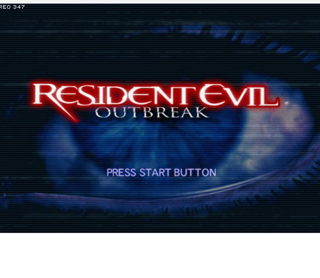

# reo: Resident Evil Outbreak, recompiled

A static recompilation of Resident Evil Outbreak (PS2, NTSC-U SLUS-20765) to native Windows
x86-64 code, built on [PS2Recomp](https://github.com/ran-j/PS2Recomp). You supply your own disc;
the recompiler turns its code into C++ on your machine, and that is built against PS2Recomp's
runtime.

> Fan project, not affiliated with Capcom or Sony. The repo contains no game code or data.
> **Generated source is not distributed**: you run the recompiler locally and its output lands in
> the gitignored `recomp/config/output*/` folders.

## Status

**Alpha. It boots and loads its title overlay on its own, but does not draw the title screen
yet.** No release has been tagged.

The game runs its own recompiled code with no injected state. As of 2026-10-18 its own IOP
modules (CRI ADX/DTX, Capcom's sound driver, USB) run on PS2Recomp's IOP interpreter. It reads
`0FLIST.DIR` and the NETBIO archives, and loads and decompresses the title overlay (`BIN/0.DAT`
to 0x370000) itself, matching what PCSX2 shows at the same point. It then waits on the sound
driver, before the boot splash screens, and nothing is drawn yet.
Every wall so far, and how each was found, is in [docs/boot-gates.md](docs/boot-gates.md).

| Stage | State |
|---|---|
| ELF load, ~3,700 recompiled functions | works |
| Title (submain.bin) and netdnas.bin overlays recompiled and linked | works |
| Kernel threads, semaphores, interrupt handlers | works |
| SIF RPC, IOP heap, LOADFILE | works |
| Game's IRX modules (CRI ADX/DTX, Capcom sound, USB) on the IOP interpreter | works |
| CDVD file lookup and reads (`0FLIST.DIR`, NETBIO archives, `BIN/0.DAT`) | works |
| Title overlay loaded by the game | **works** |
| CRI file server (ADXF), font and archive loads | works |
| Sound driver start-up | **current wall**: its pending-job count never reaches 0 |
| Boot splash screens (AVE-TCP, warning) | not reached |
| Title screen drawn by the game | not reached |
| Attract demo | not reached |
| New game | not reached |
| Sound output (SPU2) | not implemented |
| File #2 (SLUS-20984) | builds; no boot work |
| Online play | out of scope for now |

## Screenshots



This is from March 2026, **not** from the current build. It came from the earlier "puppet"
approach: the framebuffer was captured from PCSX2 and written into the window, so the game itself
did not draw it. The current build draws nothing recognisable yet. It will be replaced with a real
capture once the game reaches its title screen on its own.

## Getting Started

You need your own copy of **Resident Evil Outbreak, NTSC-U (SLUS-20765)**: the disc in a drive, or
the disc's files copied to a folder (the folder that holds `SLUS_207.65` and `BIN\`).

### Quick start

1. Download this repo (Code → Download ZIP, or clone it) and unzip it somewhere with ~15 GB free.
2. Double-click **`Setup.cmd`**.
3. It checks for Git, Visual Studio 2022, CMake and Python, and tells you what's missing and where
   to get it (it never installs anything by itself).
4. It finds the game disc, or asks for the folder, and copies the files into `game_data\`.
5. It builds PS2Recomp, recompiles the game, and builds `reo_recomp.exe`. The last build takes
   20-40 minutes.
6. Double-click **`run-reo.cmd`**.

If it stops, it prints one sentence on what to do and keeps the details in `scratch\setup.log`.
Running it again carries on from the step that failed.

`Setup.cmd --check` only checks the prerequisites.

### Step by step

Prerequisites, tested versions in brackets:

- Windows 10/11 x64
- Visual Studio 2022 with "Desktop development with C++" [17.x]
- CMake ≥ 3.20 [4.2.1]
- Python 3 with the `py` launcher [3.13]
- Git
- ~2 GB of RAM per parallel compiler job (8 jobs by default; `-DREO_COMPILE_JOBS=4` for less)

Run everything from the repo root in Git Bash (or adapt the slashes for cmd).

1. Fetch the toolkit:
   ```
   git submodule update --init --recursive
   ```
2. Copy your disc's files into `game_data/` so that `game_data/SLUS_207.65` and
   `game_data/BIN/0.DAT` exist.
3. Configure and build PS2Recomp (the first configure downloads its libraries):
   ```
   cmake -S third_party/PS2Recomp -B third_party/PS2Recomp/out/build-upstream \
         -G "Visual Studio 17 2022" -A x64 -DPS2X_BUILD_STUDIO=OFF -DPS2X_ENABLE_FFMPEG=OFF
   cmake --build third_party/PS2Recomp/out/build-upstream --config Release \
         --target ps2_runtime ps2_iop ps2_recomp
   ```
   Keep `PS2X_ENABLE_FFMPEG=OFF`: ON links shared FFmpeg and the exe then needs its DLLs.
4. Recompile the game ELF and the two overlays:
   ```
   ./third_party/PS2Recomp/out/build-upstream/ps2xRecomp/Release/ps2_recomp.exe recomp/config/outbreak.toml
   py -3 tools/gen_overlay.py game_data/BIN/0.DAT overlay registerOverlayFunctions recomp/config/output_overlay
   py -3 tools/gen_overlay.py game_data/BIN/4.DAT netdnas registerNetdnasFunctions recomp/config/output_netdnas
   ```
5. Configure and build the game:
   ```
   cmake -S recomp -B recomp/build -G "Visual Studio 17 2022" -A x64
   cmake --build recomp/build --config Release --target reo_recomp
   ```
6. Run it:
   ```
   ./recomp/build/Release/reo_recomp.exe --game file1
   ```
   Expected: the banner, then `[BOOT]` lines (`[BOOT] overlay: loaded netdnas.bin at 0x006E0000`,
   `[BOOT] Registering overlay functions ...`) and the runtime's log. A window opens showing the
   GS framebuffer.

Trip-ups:

- **`python` opens the Microsoft Store.** That's the Store alias; use `py -3`, or turn the alias
  off in Settings → Apps → Advanced app settings → App execution aliases.
- **A tool "isn't found" right after installing it.** Open a new terminal so PATH updates.
- **Edits under `third_party/PS2Recomp/ps2xRuntime` do nothing.** The game links the runtime as a
  prebuilt `.lib`; rebuild step 3 before step 5.
- **Link errors on `entry_*` symbols after regenerating.** Re-run the configure in step 5; it
  globs the generated files.

## Usage

```
reo_recomp.exe [--game file1|file2] [--elf <path>] [--data <path>]
```

`--data` defaults to `game_data` (File #2: `game_data_file2`), `--elf` to `<data>/SLUS_207.65`.

Run without a window (over RDP, with the monitor asleep, in scripts):

```
REO_HEADLESS=1 ./recomp/build/Release/reo_recomp.exe --game file1
```

Debugging switches are environment variables, all off by default. The most useful:

```
PS2X_WATCH_WRITE=0x29F708     # who writes this guest word (pc, ra, sp of every store)
PS2X_TRACE_RANGE=0x6e0000:0x751000   # is anything in this range ever entered?
PS2X_TRACE_SYNC=1             # threads, semaphores, RPC binds and calls
PS2X_TRACE_IRQ=1              # interrupt dispatches and DMA kicks
```

The full list and the method that has found every boot wall so far: [docs/debugging.md](docs/debugging.md).

## Building from source

Steps 3-5 above are the whole build. Two things to know (more in
[docs/architecture.md](docs/architecture.md)):

- The toolkit and the game are **separate CMake trees**. Rebuild the toolkit first after any
  change under `third_party/PS2Recomp`.
- PS2Recomp's own test suite: `cmake --build third_party/PS2Recomp/out/build-upstream --config
  Release --target ps2x_tests`, then
  `./third_party/PS2Recomp/out/build-upstream/ps2xTest/Release/ps2x_tests.exe`.

`src/`, most of `runtime/` and `network/` are an early hand-written hardware layer that is **not
used** by the running game; see the architecture doc.

## Documentation

- [docs/architecture.md](docs/architecture.md): the parts, the two build trees, data flow
- [docs/boot-gates.md](docs/boot-gates.md): every boot wall, its cause and fix; the current wall
- [docs/debugging.md](docs/debugging.md): trace switches and method
- [docs/mwo3-overlay-format.md](docs/mwo3-overlay-format.md): the overlay container format
- [ROADMAP.md](ROADMAP.md), [CHANGELOG.md](CHANGELOG.md)

## References

- [PS2Recomp](https://github.com/ran-j/PS2Recomp): the recompiler and runtime (GPL-3.0)
- [PS2Tek](https://psi-rockin.github.io/ps2tek/): PS2 hardware documentation
- [Outbreak Research](https://outbreak-research.github.io/Documentation/): file format documentation
- PCSX2 is used as a black box to compare against: GS dumps and guest memory captures

## Contributors

See [CONTRIBUTING.md](CONTRIBUTING.md). Codegen fixes in the PS2Recomp fork this project first
tracked (VU0 dest-mask, FPU divide-by-zero, 64-bit branches) came from
[@jlsandri](https://github.com/jlsandri); most have since landed upstream.

## License

GPL-3.0 (see [LICENSE](LICENSE)). reo links PS2Recomp's GPL-3.0 runtime, so the combined program
is GPL. Third-party code and its licences are listed in [NOTICE](NOTICE).

Resident Evil is a trademark of Capcom. PlayStation is a trademark of Sony Interactive
Entertainment.
